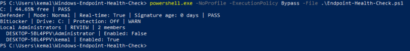
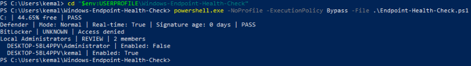

# Windows Endpoint Health Check

A read-only PowerShell tool for checking basic Windows endpoint health and security configuration. Built as a practical IT support project for Windows 10/11.

## Why I built this

IT support technicians often need to check a computer's disk space, antivirus status, encryption protection and local administrator access when troubleshooting an issue. This script brings those checks together in one place.

## Features

| Check | What it does |
|---|---|
| Disk Space | Checks fixed drives and warns when free space is below 15%. |
| Microsoft Defender | Checks running mode, real-time protection and antivirus signature age. |
| BitLocker | Checks system drive encryption protection status. |
| Local Administrators | Lists local administrator accounts and their enabled status where available. |

Results use PASS, WARN, REVIEW or UNKNOWN. REVIEW means manual assessment is needed; UNKNOWN means the information could not be confirmed.

## Requirements

- Windows 10/11
- Windows PowerShell 5.1
- Administrator access recommended for more complete results
- Some security features and PowerShell commands may be unavailable depending on the Windows installation

## How to run

Clone the repository, open PowerShell in the project directory and run:

```powershell
powershell.exe -NoProfile -ExecutionPolicy Bypass -File .\Endpoint-Health-Check.ps1
```

Only run scripts you have inspected and trust. The execution-policy override applies to the launched process rather than changing the machine's persistent policy.

## Example output

```text
C: | 44.65% free | PASS
Defender | Mode: Normal | Real-time: True | Signature age: 0 days | PASS
BitLocker | Drive: C: | Protection: Off | WARN
Local Administrators | REVIEW | 2 members
  PC\Administrator | Enabled: False
  PC\LocalUser | Enabled: True
Report saved: Health-Report-YYYYMMDD-HHMMSS.txt
```

Example account and computer names are anonymised.
## Test Evidence

### Administrator Test
All four health checks running with administrator permissions.



### Standard User Test
Demonstrates graceful handling of restricted BitLocker access.



### Additional Evidence
- [Microsoft Defender status](screenshots/02-defender-check.png)
- [Timestamped report export](screenshots/05-report-export.png)
  
## Testing

Tested on a Windows 10 virtual machine:

- Disk space and Defender: returned PASS in tested conditions.
- BitLocker: returned WARN (protection off) when accessible with administrator privileges.
- BitLocker: returned UNKNOWN (access denied) in a non-administrator test.
- Local Administrators: returned REVIEW and listed two group members.
- Report export: successfully generated a timestamped text file.

These tests verify observed behaviour, not every possible error condition.

## Limitations

- Checks only the local Windows computer.
- Does not change settings or automatically fix problems.
- Some results require administrator privileges.
- Windows feature availability and security product configurations vary.
- Local administrator membership requires human review; membership alone does not prove a security problem.
- Does not check pending Windows updates or provide remote monitoring.
- Generated reports can contain sensitive account and computer names; raw reports should not be published.

## Purpose

This project demonstrates basic Windows troubleshooting, PowerShell scripting, security awareness, permission handling and technical documentation.
